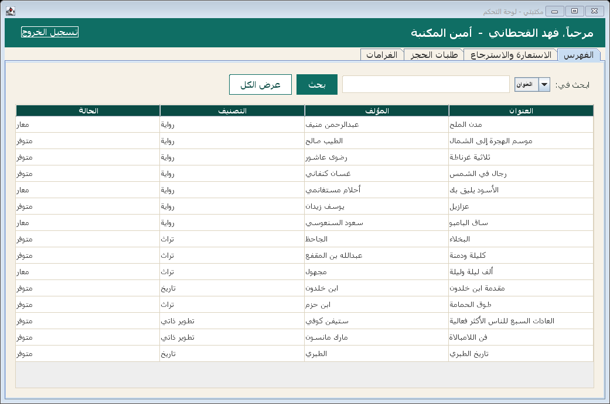
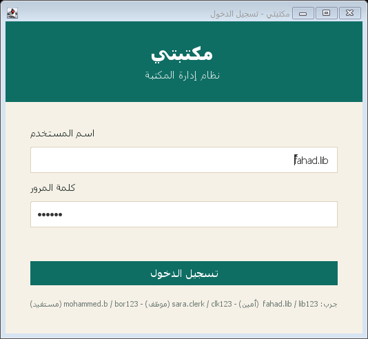
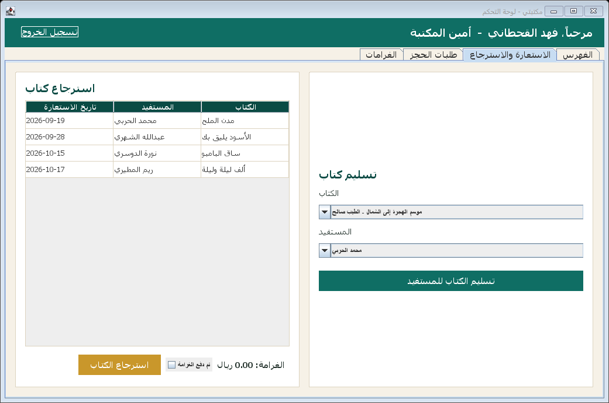
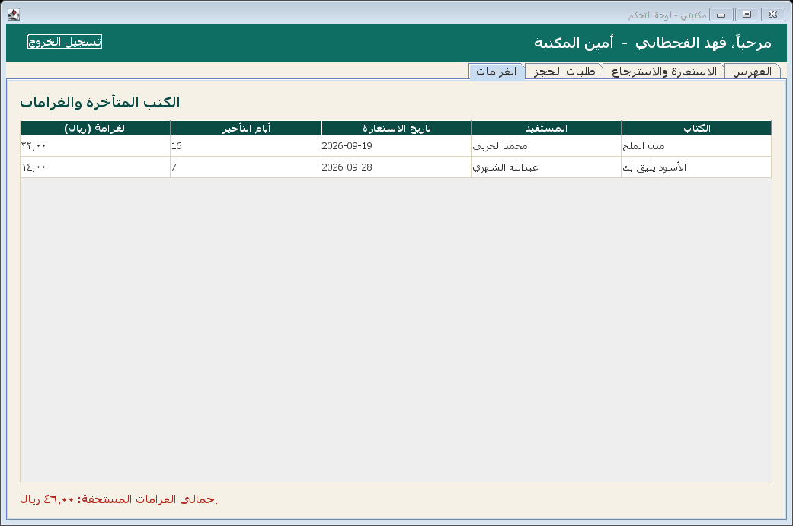

# مكتبتي 📚

نظام إدارة مكتبة مكتوب بلغة Java، مبني على تصميم OOP نظيف (وراثة، تغليف، Singleton) مع واجهة رسومية Swing بالكامل بالعربي ومتجهة من اليمين لليسار. تقدر تسجل دخول كأمين مكتبة أو موظف استقبال أو مستفيد، تدور على الكتب، تسلّم وتسترجع الكتب، تدير طلبات الحجز، وتتابع الغرامات على الكتب المتأخرة - كل شي متصل بقاعدة بيانات SQLite حقيقية.



## المصدر الأصلي

هذا المشروع مبني فوق مشروع مفتوح المصدر: [harismuneer/Library-Management-System-JAVA](https://github.com/harismuneer/Library-Management-System-JAVA)، مرخّص بـ MIT، من تطوير **harismuneer** و **MahamAmjad** كمشروع جامعي لمادة Object Oriented Analysis and Design. المشروع الأصلي كان تطبيق Console فقط (بدون أي واجهة رسومية)، يستخدم قاعدة بيانات Apache Derby المضمّنة (ملفات binary محفوظة داخل المستودع)، وبنية الصفوف فيه كانت على مستوى package واحد مسطّح.

تصميم الكلاسات الأساسي (`Person` ← `Staff` ← `Librarian`/`Clerk`، `Person` ← `Borrower`، و`Book`/`Loan`/`HoldRequest`) هو تصميم المشروع الأصلي، وما ادعيت إني صممته من الصفر - أنا حافظت عليه لأنه تصميم OOP نظيف ومرتب.

**اللي سويته أنا فوق هذا الأساس:**

- **واجهة Swing رسومية كاملة من الصفر** - المشروع الأصلي ما فيه أي واجهة غير قائمة Console نصية. سويت شاشة تسجيل دخول، لوحة تحكم حسب الدور (أمين/موظف/مستفيد)، شاشة فهرس وبحث، شاشة استعارة واسترجاع، شاشة طلبات الحجز، وشاشة الغرامات - كلها بتصميم مخصص وبالعربي RTL بالكامل.
- **ترحيل قاعدة البيانات بالكامل من Apache Derby المضمّن إلى SQLite عبر JDBC** - حذفت ملفات الـ Derby الـ binary القديمة من المستودع، وكتبت طبقة DAO منفصلة تماماً عن طبقة النطاق (domain)، مع `schema.sql` وملف Seeder يعبّي بيانات تجريبية سعودية واقعية.
- **إعادة تنظيم الكود إلى حزم (packages) نظيفة**: `model` (الكيانات)، `dao` (الحفظ في SQLite)، `service` (منطق الأعمال، تطوير لكلاس `Library` الأصلي)، `ui` (طبقة Swing الجديدة) - بدل package واحد مسطّح في الأصل.
- **طبقة خدمة (`LibraryService`) خالية تماماً من مدخلات Console** - المنطق الأصلي كان يستخدم `Scanner` و`System.out.println` داخل كلاس `Library` نفسه، وهذا يمنع إعادة استخدامه من واجهة تانية. أعدت كتابته كدوال نقية تاخذ مدخلات وترجع نتائج أو تطلع استثناء، عشان تصير قابلة للاستخدام من الواجهة الرسومية وقابلة للاختبار مباشرة.
- **اختبارات JUnit 5 حقيقية** لمنطق الاستعارة، الاسترجاع، طابور طلبات الحجز، وحساب الغرامات.
- **حساب الغرامة والتأخير** معاد كتابته كدالة نقية على `Loan` (بدون أي اعتماد على Singleton أو تاريخ ثابت)، ومربوط فعلياً بشاشة الغرامات في الواجهة.

## وش فيه

- تسجيل دخول باسم مستخدم وكلمة مرور حقيقية محفوظة في قاعدة البيانات (مو مجرد رقم ID كما في الأصل)
- ثلاث أدوار: أمين مكتبة، موظف استقبال، مستفيد - كل دور يشوف شاشات مختلفة (من تصميم الأصل، موروث هنا)
- فهرس بحث بالعنوان أو المؤلف أو التصنيف
- تسليم واسترجاع الكتب مع احترام طابور طلبات الحجز (قاعدة FIFO - أول واحد طلب الحجز أول واحد ياخذ الكتاب، من منطق الأصل)
- طلبات حجز للكتب المعارة، مع دور تلقائي وانتهاء صلاحية بعد مدة معينة
- حساب غرامات تلقائي للكتب المتأخرة عن موعد الإرجاع، معروض بشاشة مخصصة
- قاعدة بيانات SQLite حقيقية بدل الملفات الثنائية القديمة، تتعبى تلقائياً ببيانات تجريبية عند أول تشغيل
- اختبارات وحدة (Unit Tests) حقيقية لمنطق الأعمال الأساسي

## صور

| | |
|---|---|
|  | شاشة تسجيل الدخول، بالعربي RTL مع بيانات تجربة جاهزة |
|  | شاشة تسليم واسترجاع الكتب مع حساب الغرامة مباشرة |
|  | شاشة الكتب المتأخرة وإجمالي الغرامات المستحقة |

## بيانات تجربة

بعد تشغيل البرنامج أول مرة بيتعبى قاعدة البيانات تلقائياً بهذي الحسابات:

| الدور | اسم المستخدم | كلمة المرور | الاسم |
|---|---|---|---|
| أمين مكتبة | `fahad.lib` | `lib123` | فهد القحطاني |
| موظف استقبال | `sara.clerk` | `clk123` | سارة العتيبي |
| موظف استقبال | `nasser.clerk` | `clk123` | ناصر الزهراني |
| مستفيد | `mohammed.b` | `bor123` | محمد الحربي |
| مستفيد | `noura.b` | `bor123` | نورة الدوسري |

## التشغيل

يحتاج **JDK 21**. إذا ما كان الـ JDK على الـ PATH عندك (زي بيئة التطوير اللي بنيت فيها المشروع)، صدّر هذا قبل أي أمر:

```bash
export PATH="/c/Program Files/Eclipse Adoptium/jdk-21.0.12.101-hotspot/bin:$PATH"
```

بعدين:

```bash
# على ويندوز (CMD)
build.bat
run.bat

# على Linux / macOS / Git Bash
./build.sh
./run.sh
```

أول تشغيل بينشئ ملف `maktabati.db` تلقائياً ويعبّيه بالبيانات التجريبية. مكتبة SQLite JDBC موجودة جاهزة في `lib/sqlite-jdbc.jar` (ما تحتاج Maven ولا Gradle).

لتشغيل الاختبارات:

```bash
# ويندوز
test.bat

# Linux / macOS / Git Bash
./test.sh
```

## التقنيات

- **Java 21**
- **Swing** للواجهة الرسومية (بتصميم مخصص RTL بالكامل)
- **JDBC + SQLite** للحفظ (`lib/sqlite-jdbc.jar`)
- **JUnit 5** للاختبارات (`lib/junit-platform-console-standalone.jar`)
- بناء مباشر بـ `javac`/`jar` بدون Maven أو Gradle
